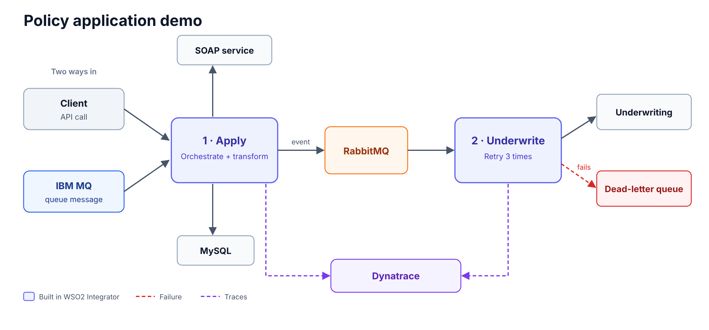

# integrator-soap-mq-demo

WSO2 Integrator demo: a policy application flows from a SOAP service into MySQL and RabbitMQ,
with retry and dead-letter handling and OpenTelemetry tracing. The same application can also arrive
as a message on an IBM MQ queue.



## What it shows

1. **Orchestration:** `POST /applications` calls a SOAP service (client generated from a WSDL with `bal wsdl`), maps the response, and inserts a row into MySQL.
2. **Events:** the flow publishes an `application.received` event to RabbitMQ. A second flow consumes it and calls a downstream underwriting stub.
3. **Guaranteed delivery:** if underwriting fails, the consumer retries 3 times, then nacks. The broker dead-letters the message to `application.received.dlq`.
4. **Tracing:** traces go out over OTLP/HTTP. Tested against a Dynatrace trial tenant.
5. **IBM MQ:** a listener picks up application requests from an IBM MQ queue and runs the same intake logic as the HTTP endpoint. Both entry points call one shared function (`createApplication` in `intake.bal`). This path has no retry or dead-letter handling; a message that cannot be processed is logged and dropped.

## Layout

| Path | What |
|---|---|
| `american_national_demo/application_intake/` | The WSO2 Integrator (Ballerina) package |
| `mocks/` | SOAP mock service (`soap_mock.py`, `customer.wsdl`) and underwriting stub |
| `rabbitmq/` | Broker definitions: exchange, queues, dead-letter policy |
| `mysql-init/` | Schema for the `insurance` database |
| `docs/` | Architecture diagram (PNG and editable SVG) |
| `docker-compose.yml` | RabbitMQ, MySQL, Jaeger (optional), IBM MQ |
| `dynatrace-snippet.toml` | Tracing settings with placeholders |

## Run it

Prerequisites: Docker, Python 3, Ballerina 2201.14.x (WSO2 Integrator 5.1).

```
docker compose up -d
python3 mocks/soap_mock.py              # SOAP service on :8089
python3 mocks/underwriting_stub.py      # underwriting stub on :8090
```

Create `american_national_demo/application_intake/Config.toml` (it is gitignored):

```
dbPassword = "apppass"
dbHost = "127.0.0.1"
dbPort = 3307
rabbitmqPassword = "demo"
mqPassword = "passw0rd"
```

The IBM MQ client jar is declared in `Ballerina.toml` (`com.ibm.mq.allclient` 9.4.1.0) and is downloaded from Maven on the first build.

Then, from `american_national_demo/application_intake`:

```
bal run
curl -i -X POST localhost:8085/applications -H 'Content-Type: application/json' \
  -d '{"customerId":"C1001","product":"TERM_LIFE"}'
```

Known customer IDs: `C1001`, `C1002`, `C1003`. Other IDs return a generated customer.

### Break and recover underwriting

```
curl -X POST localhost:8090/admin/fail     # consumer retries, then dead-letters
curl -X POST localhost:8090/admin/ok
```

Inspect `application.received.dlq` in the RabbitMQ UI.

### Send an application through IBM MQ

With the app running, put the same request body on the queue:

```
echo '{"customerId":"C1001","product":"TERM_LIFE"}' | docker exec -i an-ibmmq /opt/mqm/samp/bin/amqsput DEV.QUEUE.1 QM1
```

The log shows `IBM MQ message received` and then `Application created from IBM MQ`. A row is
inserted into MySQL and the `application.received` event is published, exactly as for the API call.
You can also add a message from the MQ console (https://localhost:9443/ibmmq/console, queue `DEV.QUEUE.1`).

## Demo credentials

These protect local containers only. They are not real secrets.

| Service | Where | Login |
|---|---|---|
| RabbitMQ | localhost:5672, UI :15672 | demo / demo |
| MySQL | localhost:3307, db `insurance` | app / apppass |
| IBM MQ | localhost:1414 (QMGR `QM1`), console :9443 | app / passw0rd, admin / passw0rd |

IBM MQ runs under amd64 emulation on Apple Silicon.

## Tracing

Add this to `Config.toml` (see `dynatrace-snippet.toml`). Never commit a real token.

```
[ballerina.observe]
tracingEnabled = true
tracingProvider = "otel"

[ballerina.otel]
tracesEndpoint = "https://<environment-id>.live.dynatrace.com/api/v2/otlp/v1/traces"
tracesProtocol = "http/protobuf"
tracesExporterHeaders = "Authorization=Bearer <platform-token>"

[ballerina.otel.tracesResourceAttributes]
"service.name" = "application-intake"
```

Notes from testing:

- Use a plain space after `Bearer`. A percent-encoded `%20` is not decoded and Dynatrace answers 401, even though the exporter still logs success.
- The environment ID must not include `.apps`.
- The RabbitMQ publish and consume appear as two separate traces. Trace context is not propagated through the broker.
- A dead-lettered message is not marked as a failure by default, because the span itself ends normally. The consumer adds an `error=true` tag to the span, and a custom failure-detection rule in Dynatrace (Settings, Service detection, Failure detection) matches that tag. Without the rule, failed messages show as successful.

## Not done yet

- Kafka listener (planned as a configuration-only walkthrough)
